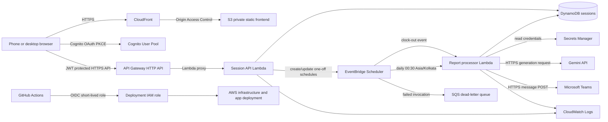

# Work Update Automation — Project Handoff

This document is the start-to-finish handoff for the work-update application. It describes the repository, the AWS resources, how the current implementation behaves, and the requested clock-in / clock-out workflow that still needs implementation. A future developer or Codex session should read this file before changing the application.

> **Status language:** “Current” means present in this repository now. “Target behavior” means requested by the owner and still requiring code/configuration changes unless explicitly stated as implemented. Do not treat planned behavior as deployed behavior.

## 1. Project goal

This is a personal, mobile-accessible work-session and work-update tool. The user records clock-in and optionally clock-out, keeps sprint/work context, and supplies the relevant ChatGPT conversation URL and transcript. At the right time, the backend calculates durations, asks Gemini to write a factual professional update, and sends the final message to a Microsoft Teams destination. Work must continue if the user's phone or computer is offline after saving.

The application is moving from its legacy Cloudflare implementation to AWS. The desired AWS deployment is serverless and uses Terraform and GitHub Actions OIDC. No EC2 instance, VPC, or NAT Gateway is needed for the current integrations.

## 2. Repository map

```text
.
├── index.html                         Static mobile-friendly application page
├── css/style.css                      Frontend styling
├── js/
│   ├── app.js                          Sign-in, form, session status and UI actions
│   ├── api.js                          Authenticated API request helper
│   ├── config.js                       Deployment-generated public AWS frontend config
│   ├── helpers.js, status.js, ui.js    Shared/older UI helpers
├── application/lambda/
│   ├── package.json / package-lock.json
│   ├── package-and-upload.sh           Builds deterministic Lambda ZIPs and uploads them
│   ├── src/
│   │   ├── session.js                  Cognito-authenticated session API handler
│   │   ├── processor.js                Scheduled fallback/report/Gemini/Teams handler
│   │   ├── aws.js                      DynamoDB, Scheduler and Secrets Manager clients
│   │   ├── http.js                     API Gateway response/auth helpers
│   │   └── domain/                     Timezone, duration and input validation logic
│   └── test/session-domain.test.js     Lambda domain tests, run by CI packaging workflow
├── terraform/
│   ├── bootstrap/                      Per-account OIDC, deployment role, state/artifact buckets
│   ├── environments/dev/               Composition/configuration for the dev application stack
│   ├── modules/                        Reusable AWS resource modules
│   ├── README.md                       Terraform and account setup runbook
│   └── ...
├── .github/workflows/
│   ├── terraform.yaml                  Manual Terraform plan/apply/destroy workflow
│   └── deploy-app.yaml                 Manual Lambda/frontend/secret deployment workflow
├── worker/                             Legacy Cloudflare Worker application (not AWS runtime)
├── extension/                          Browser extension files from the legacy project
├── database/ and worker/schema.sql     Legacy/D1 schema material
├── docs/                               Older architecture/API/flow notes
├── prompts/                            Legacy prompt files
└── config/                             Legacy/sample settings; never put real secrets here
```

Terraform does not delete, import, or manage the old Cloudflare Worker or browser extension. Keep those files until the AWS behavior is verified and the owner approves a separate cleanup/cutover.

## 3. Current AWS architecture



### Request flow (current implementation)

1. CloudFront serves `index.html`, CSS, JavaScript, and a generated `js/config.js` from a private S3 bucket. CloudFront Origin Access Control reads the bucket; the bucket is not public.
2. The user signs in using Cognito Hosted UI OAuth authorization code flow with PKCE. The browser keeps the ID token in `sessionStorage` for that browser session.
3. `js/api.js` sends the token as `Authorization: Bearer ...` to API Gateway. API Gateway's JWT authorizer checks the Cognito issuer and client audience before invoking Lambda.
4. `session.js` derives the Cognito `sub` principal from the authorized request. It validates input and reads/writes the user's session in DynamoDB. The user cannot choose another user's partition key.
5. When a clock-out is provided, the API creates or updates an EventBridge Scheduler one-time schedule. The schedule includes the session ID and schedule version. Obsolete events are checked against current DynamoDB state by the processor.
6. The recurring schedule invokes the processor at 00:30 in the configured IANA timezone (currently `Asia/Kolkata`). A phone/browser is not involved in scheduled execution.
7. `processor.js` claims a conditional DynamoDB lease, reads Gemini/Teams credentials from Secrets Manager (cached in the warm Lambda process for up to five minutes), calls Gemini, records the generated report, posts to Teams, and records delivery state.

### Scheduled flow (current implementation)

- Terraform creates the recurring 00:30 fallback schedule, schedule group, Scheduler invocation role, report Lambda, and SQS DLQ.
- The Session API creates a one-time schedule at the explicit clock-out time, and increments `scheduleVersion` when the session is edited.
- On a scheduled invocation, the processor re-reads the record. A stale schedule version exits without processing. Conditional state updates and a five-minute lease prevent normal overlapping invocations from sending twice.
- The fallback queries eligible status partitions in the table's due-status GSI. It currently looks for prior-work-date sessions, requires a clock-in, skips already delivered or ambiguous deliveries, and considers explicit clock-out due only if its timestamp has passed.
- Current fallback with a missing clock-out uses midnight at the end of the selected work date (`zonedMidnight`). It does **not** yet use 23:30.

## 4. What the current application does and does not do

### Implemented in the AWS application

- Static frontend for phone/desktop browsers.
- Cognito sign-in with PKCE; protected API routes.
- Work date, clock-in date-time, optional clock-out date-time, sprint enablement and sprint date-times, ticket reference, ChatGPT URL, and pasted transcript fields.
- Input validation including full date-time and timezone-aware conversion (`Asia/Kolkata` by default), explicit overnight dates, and duration calculation in minutes.
- DynamoDB persistence, optimistic version checks, per-user data partition, schedule versions, idempotency key, execution lease, statuses, error category, and retention TTL for completed/failed records.
- Per-clock-out EventBridge schedule and daily 00:30 fallback.
- Gemini prompt/request/JSON parsing, bounded retry for select transient errors, report persistence before delivery, and error status.
- Teams webhook POST and delivery state persistence. Delivery is marked `DELIVERY_UNKNOWN` before the external side effect so an ambiguous timeout does not trigger a blind automatic duplicate. The user can verify delivery or explicitly accept duplicate risk to retry.
- CloudWatch logs/alarms and deployment through short-lived GitHub OIDC credentials.

### Important current behavior gaps relative to the requested final workflow

1. **No immediate clock-in Teams notification yet.** Saving clock-in currently stores the session only. Add a separately tracked, idempotent clock-in notification (`clockInDeliveryStatus`, attempt ID, and ambiguity handling) that posts immediately after a valid first clock-in.
2. **The Teams report does not yet use the owner's full message template.** The processor currently sends the generated three-paragraph report as the Teams text. It does not add `ELEPHANT`, clock-in/out, duration, current ticket, email status, blocker, or the `Today's update -` label.
3. **Email/blocker inputs are absent.** The current frontend/data validation has `ticketReference`, but not an email checked/status field or blocker field. Add these, decide whether blocker is free text or “none”, and include them only as appropriate in the final message.
4. **The transcript is required for report generation.** The conversation URL is validated and stored as a reference, but the AWS application does not retrieve conversation content from that URL. The user must paste the relevant transcript. A missing transcript stops processing and does not fabricate an update. Do not add private-cookie scraping or bypass access controls.
5. **Fallback clock-out differs from the new request.** Existing implementation uses midnight after the session date; the owner now suggests a default “11:30 or something.” Interpret that as a configurable local `23:30` (11:30 PM) only after confirming the intended value. Until then, do not silently change the current calculation.
6. **Clock-out scheduling differs from the new requested timing.** Current one-time event runs at the supplied clock-out. The requested final rule is to check at clock-out + 10 minutes for clock-outs after the 00:30 fallback. Implement and document the cutoff date/time precisely.
7. **Completed sessions are not removed from the active record.** They remain in DynamoDB and are hidden only by their `COMPLETED` state/TTL lifecycle. The requested flow needs a clear active session (empty/null after completion) plus retained history/log entries.
8. **Current frontend edits/loads sessions by work date.** It does not yet have a separate active-session view and history view. Its status polls every 30 seconds while open, but background/browser execution is not used for automation.
9. **Prompt wording is older than the provided template.** Current generation demands exactly three paragraphs and excludes the words “today” and “yesterday”; the supplied example uses “Today's update” as a label and begins with “Today”. Align generation rules with the approved template instead of assuming the sample work details are reusable content.

## 5. Requested final user experience and business rules

### Work-session form

The mobile-first page should allow the authenticated user to enter or correct:

- Clock-in date and time.
- Optional clock-out date and time.
- ChatGPT conversation URL and pasted conversation transcript (until an authorized supported retrieval method exists).
- Current ticket/work item.
- Email status (for example `checked`).
- Blocker status/text (`none` if there is no blocker; omit blocker line only if the owner chooses that format).
- Sprint checkbox and sprint start/end date-times, shown only if enabled.

All times are full local date-time values interpreted with the configured IANA timezone, initially `Asia/Kolkata`; store normalized UTC instants and the original local value/timezone. Clock-out before clock-in must use the correct date for overnight work; do not silently guess the next day.

### Clock-in operation

1. Validate the authenticated request, work date, clock-in, URL, and other values.
2. Conditionally create/update exactly one active session for the user and work date. Repeated save/taps must not create multiple sessions.
3. Commit the session and notification idempotency key before sending the clock-in notification.
4. Send a Teams message immediately, such as `ELEPHANT\nClock in - 14:12` (confirm final exact clock-in format with the owner).
5. Persist the clock-in message result separately from final report delivery. If Teams may have accepted but the response/status write is lost, record an ambiguous state and do not blindly replay it.
6. If clock-out is already supplied, create/update the versioned schedule; otherwise wait for an edit or fallback.

### Final Teams report template

Use this template as the message contract. Replace the sample values with actual session data and Gemini output; never reuse the sample's project/tasks as new report facts.

```text
ELEPHANT

Clock in - {HH:mm}

Clock out - {HH:mm}

Total hours - {H} hrs {MM} mins

Current ticket - {ticket}

Email - {email status}

Blocker - {blocker text or none}

Today's update - {Gemini-generated factual update, usually three concise paragraphs}
```

Example supplied by the owner (format reference only; the content is not generated project data):

```text
ELEPHANT

Clock in - 14:12

Clock out - 23:20

Total hours - 9 hrs 08 mins

Current ticket - GitHub password rotation

Email - checked

Blocker - none

Today's update - Today, I worked on the deployment pipeline for the ms-opendesk service, focusing on configuring and validating the build and deployment process to ensure everything runs smoothly.

I also worked on the service’s ConfigMap and values.yaml files to ensure the application configuration and deployment settings were properly defined and aligned with the requirements.

The build and deployment jobs are now working fine, and both processes are completing successfully. However, the pod is currently in a degraded state, so I am continuing to investigate the issue and will work toward resolving it to ensure the service runs properly in the QA environment.
```

Duration must be computed from instants, then formatted as hours plus remaining minutes (example: 14:12 → 23:20 = 9 hrs 08 mins). Sprint duration is independent; include it only when enabled and complete, according to the final message format the owner approves.

### 00:30 fallback and explicit clock-out rules

The 00:30 trigger runs every day in `Asia/Kolkata` (or configured timezone), independently of the browser:

1. Query the current active session(s) eligible for that work date. If there is no session/clock-in, stop; do not generate or send a report.
2. If explicit clock-out is before the next 00:30 fallback, the one-time schedule attempts the report at the supplied clock-out time. At 00:30, re-read current session and delivery state. If already delivered, archive/close it and clear the active session. If it is missing and processing is safely recoverable, acquire the conditional lease, generate and send once, then archive/clear only after successful confirmed delivery. The early clock-out invocation itself sends the report but does not clear the active record; the 00:30 worker performs that cleanup.
3. If clock-out is still empty, use the configured fallback clock-out and origin (suggested `23:30` local on the intended work date; **owner confirmation required before implementation**), calculate duration, generate, deliver, then archive/clear after successful delivery.
4. If explicit clock-out is later than the current 00:30 check (example: 00:45), do not replace it with the fallback default and do not send early. Create/update a one-time check at explicit clock-out + 10 minutes (example: 00:55). That invocation re-reads latest state and delivery status; if already sent it closes/archives the session, otherwise it safely processes and sends, then closes/archives. This post-00:30 scheduled check is allowed to clear the active record after it confirms delivery.
5. If generation/delivery fails, keep the active record and error state for inspection/recovery. Never clear it as if delivered.
6. Clock-out edits increment a schedule version. Every scheduled invocation compares its captured version with the latest record and exits if stale. Deleting/updating a schedule alone is not sufficient because a previously delivered invocation may still run.
7. Fallback and one-time schedule events use the same conditional lease/idempotency rules. A concurrent loser exits. A completed/delivered state prevents ordinary replays.

The current code uses midnight for missing clock-out, schedules explicit clock-out at its exact timestamp, and does not archive/delete the active item after delivery. Those differences must be implemented and tested before this is considered complete.

### Active session versus history

Target behavior: after Teams delivery is confirmed, the active page should show no active clock-in/out values (null/empty) and be ready for the next session. The completed report should still be available in history/logs. Only the 00:30 fallback worker or the post-00:30 clock-out check worker may perform the archive-and-clear operation; the session API must not expose a general delete/clear action.

Recommended single-table pattern:

- Active item: `PK=USER#{cognitoSub}`, `SK=ACTIVE` (or current session key with an explicit active pointer).
- History item: same `PK`, `SK=LOG#{workDate}#{sessionId}`.
- After delivery: a DynamoDB `TransactWriteItems` operation conditionally writes the history record and removes/clears `ACTIVE` only when the record's version matches and `deliveryStatus=DELIVERED`.
- Store final times, durations, ticket/email/blocker, report text, delivery IDs/status, and timestamps in history. Remove pasted transcript/URL from history unless a clear retention/business need exists. Apply a documented TTL (suggested one year) to history if desired; TTL is asynchronous cleanup, never a scheduler.
- Keep the pending/ambiguous record active. Do not archive or clear on `DELIVERY_UNKNOWN` without user review.

The current table instead uses `PK=USER#{sub}`, `SK=SESSION#{YYYY-MM-DD}` and a `status-due-index` GSI; it retains completed records with an `expiresAt` TTL. Changing to an active/history pattern requires a deliberate migration/compatibility plan, API and frontend changes, and an IAM update (processor role needs the exact DynamoDB transaction/delete operations). Do not silently replace the table or discard data.

## 6. Current state machine and safety

Current states include `READY`, `SCHEDULED`, `PROCESSING`, `GENERATING`, `DELIVERING`, `COMPLETED`, `FAILED`, and delivery substate `PENDING`, `DELIVERED`, or `DELIVERY_UNKNOWN`. Retry is bounded (three attempts by default); the processor lease lasts five minutes. Session writes use version conditions. Scheduled events carry `scheduleVersion`.

Important delivery constraint: a Teams webhook does not provide an application-controlled idempotency key/transaction. If Teams accepts a POST and the Lambda loses the response or cannot persist the success, exactly-once delivery cannot be guaranteed. Current code records `DELIVERY_UNKNOWN` before sending and blocks automatic resend. The UI asks the user to confirm the message was delivered or explicitly accept possible duplicate risk to retry. Preserve this safety in the new clock-in and final-report flows.

## 7. DynamoDB data currently stored

Current session attributes include:

- `PK`, `SK`, `userSub`, `workDate`.
- `clockIn`, `clockInLocal`, `clockOut`, `clockOutLocal`, `effectiveClockOut`, `clockOutOrigin`, `timezone`.
- `conversationUrl`, `conversationText`, `ticketReference`.
- `sprintEnabled`, `sprintClockIn`, `sprintClockInLocal`, `sprintClockOut`, `sprintClockOutLocal`, `sprintMinutes`.
- `workMinutes`, `scheduledExecutionTime`, `scheduleVersion`, `version`, `idempotencyKey`.
- `status`, `generationStatus`, `deliveryStatus`, `generatedReport`, `attemptCount`, `deliveryAttemptId`, `reportId`.
- `leaseUntil`, error category/time, created/updated/completed timestamps, and `expiresAt` for TTL.
- `GSI1PK`/`GSI1SK` for status-based fallback lookup.

Do not expose transcript or report content in logs or unauthenticated API responses. Current logs include session date and Cognito subject as correlation data, event/stage, attempts, and error category/name.

## 8. AWS resources and Terraform layout

| Resource | Purpose |
|---|---|
| S3 frontend bucket | Private static assets, accessed only by CloudFront OAC. Versioning and encryption are enabled. |
| CloudFront | Public HTTPS site, redirects HTTP to HTTPS, security response headers, OAC to S3. Optional custom domain requires ACM certificate in `us-east-1`. |
| Cognito User Pool/client/domain | Private sign-in, OAuth authorization-code + PKCE, API JWT issuer/audience. Initial user creation is admin-only. |
| API Gateway HTTP API | Protected session routes, JWT authorizer, Lambda proxy integration, access logging and CORS. |
| Lambda `session_api` | Read/create/update session, validation, and schedule management. |
| Lambda `report_processor` | Scheduled processing, fallback, Gemini generation and Teams delivery. Immediate clock-in notification is not yet implemented. |
| DynamoDB on-demand table | Session state, GSI status lookup, encryption, PITR and TTL. |
| EventBridge Scheduler | Dynamic per-session schedules plus recurring 00:30 fallback in IANA timezone. |
| SQS DLQ | Captures Scheduler target invocations that exhaust configured retries. |
| Secrets Manager | Secret containers for Gemini key and Teams webhook; values are written by the deployment workflow. |
| CloudWatch | Lambda/API logs with retention and Lambda error alarms. |
| IAM | Separate GitHub deployment role, Lambda runtime roles, and Scheduler invocation role. |

Terraform source map:

- `terraform/bootstrap/`: creates per-account versioned/encrypted/private state and Lambda artifact buckets, GitHub OIDC provider, restricted GitHub deployment role and IAM policy. Bootstrap state itself is local; do not commit it.
- `terraform/environments/dev/`: account/environment variables, provider/backend configuration and composition of reusable modules.
- `terraform/modules/s3-frontend`, `cloudfront`, `cognito`, `api-gateway`, `lambda`, `dynamodb`, `eventbridge-scheduler`, `secrets-manager`, `monitoring`, `iam`: resource-specific infrastructure.
- S3 remote state uses a key containing account ID and environment plus Terraform native S3 lock file (`use_lockfile=true`; Terraform 1.10+).
- AWS account ID, environment, region, name prefix, timezone, bucket names and domain values are variables/workflow configuration. Never bake credentials or secret values into Terraform.

The application deployment role uses short-lived GitHub OIDC credentials. Runtime roles cannot administer infrastructure. A few AWS control-plane actions have unavoidable `Resource="*"`; the bootstrap policy limits the action list and constrains the role trust to this repository/branch. See `terraform/README.md` and `terraform/bootstrap/README.md` for account setup and exact secret values.

## 9. API and frontend surface (current)

Routes configured in Terraform and implemented by `application/lambda/src/session.js`:

| Method/path | Purpose |
|---|---|
| `GET /sessions` | List the authenticated user's sessions. |
| `POST /sessions` | Create a session for the supplied work date (upserts existing date through validation/version checks). |
| `GET /sessions/{sessionId}` | Read a session; current `sessionId` is the work date. |
| `PUT /sessions/{sessionId}` | Correct an existing not-yet-delivered session and replace its schedule. |
| `POST /sessions/{sessionId}/retry` | Schedule a manual bounded retry; ambiguous delivery requires explicit duplicate consent. |
| `POST /sessions/{sessionId}/confirm-delivered` | Resolve ambiguous delivery after the user checks Teams. |

The current UI polls status every 30 seconds while open. This is display-only; automation is on AWS. The target experience should change the active lookup/history endpoints when the active/history data design is implemented. Keep authorization server-side; frontend hiding is not security.

## 10. Gemini, ChatGPT link, and Teams integrations

### ChatGPT content

The URL is a reference field; it does not currently retrieve the conversation. The old Worker has a shared-link HTML preview fetch, but that does not demonstrate a supported API for complete conversation contents. The AWS handler uses user-pasted transcript text. An invalid/unavailable/private link should not be treated as successful retrieval; missing transcript currently fails the session and sends no report. Do not use browser cookies, undocumented authenticated endpoints, or access-control workarounds. Reconsider only if an official supported export/API workflow is available.

### Gemini

`processor.js` calls the Gemini `generateContent` endpoint using `GEMINI_SECRET_ARN`, defaults to the configured model in code, requests JSON, retries selected network/429/5xx errors at most three times, checks the returned body, and requires exactly three paragraphs. Secrets Manager is the credential source. Prompt/template updates must preserve “based only on supplied verified work” and no fabricated completion.

### Microsoft Teams

The current connector is an incoming Teams webhook URL stored in the Teams secret. The processor posts JSON `{text: report}` and checks the HTTP response. Credentials stay server-side. The target template wraps the Gemini report with clock/session fields. Exact message formatting should be covered by unit tests. Any notification/report attempt must be tracked separately and safely under ambiguous success.

## 11. GitHub Actions and deploy steps

Two workflows should remain:

1. `.github/workflows/terraform.yaml` (manual dispatch): select `plan`, `apply`, or `destroy`; `destroy` requires exact `DESTROY DEV`. It uses GitHub OIDC, checks formatting/validation, uploads Lambda artifacts before a normal plan, and stores a short-lived plan artifact for apply. Destroy keeps bootstrap resources.
2. `.github/workflows/deploy-app.yaml` (manual dispatch): reads Terraform outputs, builds/updates both Lambdas, writes `GEMINI_API_KEY` and `TEAMS_WEBHOOK_URL` to their Secrets Manager secret containers, uploads frontend assets, generates public `js/config.js`, and invalidates CloudFront.

Required GitHub repository Actions secrets:

| Secret | Contents |
|---|---|
| `AWS_ACCOUNT_ID` | The target account's 12-digit ID. |
| `OIDC` | Full ARN of `office-update-dev-github-deploy` role in that account (not the OIDC provider ARN and not an IAM user ARN). |
| `TF_STATE_BUCKET` | `terraform_state_bucket_name` bootstrap output for that same account. |
| `GEMINI_API_KEY` | Gemini API key, required by Deploy application workflow. |
| `TEAMS_WEBHOOK_URL` | Intended Teams webhook URL, required by Deploy application workflow. |

Region, environment, naming pattern and timezone currently live in workflow/Terraform code. GitHub must trust the exact repository subject and `sts.amazonaws.com` audience. No static AWS access keys belong in Actions secrets. Full step-by-step account/OIDC/bootstrap instructions are in `terraform/README.md`.

## 12. Development and deployment lifecycle

1. Read this document plus `terraform/README.md` before making changes.
2. For a new AWS account, bootstrap its provider/role/buckets using authorized account credentials. Keep its local bootstrap state securely.
3. Set that account's five GitHub secrets and ensure the role trust matches the repository and `main` branch.
4. Run Terraform `plan`, inspect account and resource changes, then explicitly run `apply`.
5. Add the initial Cognito user through the approved admin path; user-pool self sign-up is disabled.
6. Configure Gemini/Teams repository secrets, then manually run Deploy application.
7. Test a non-production session with mocked external services before sending any real Teams message. A real Teams delivery test must be explicitly planned to avoid accidental work-channel posts.
8. Verify mobile login, API authorization, stored status, clock-in notification, clock-out scheduling, 00:30 fallback, history/archive, retry/ambiguous behavior, logs, and alarms.
9. Compare AWS behavior with the retained Cloudflare implementation. Cut over only after owner approval; do not delete old Cloudflare resources as part of AWS deployment.

Application runtime is outside a VPC, avoiding NAT cost. Potential charges include CloudFront transfer/requests, S3, API Gateway, Lambda, DynamoDB/PITR, EventBridge, Cognito, Secrets Manager, CloudWatch, and Gemini usage. Do not advertise the system as completely free.

## 13. Implementation plan for the requested workflow

1. **Resolve business rules:** confirm fallback clock-out (suggested 23:30 local), whether email/blocker are always included, exact clock-in notification text, clock-out cutoff/date semantics, sprint display, and history retention.
2. **Data lifecycle:** add active-session/history behavior, safe archive transaction, TTL policy, and clear error recovery. Plan migration for existing `SESSION#date` items.
3. **Clock-in delivery:** implement immediate Teams notification with a separate idempotency/delivery state; protect concurrent saves and ambiguous outcomes.
4. **Scheduling:** implement exact clock-out behavior, post-00:30 `clockOut + 10 minutes` verification event, fallback decision rules, stale schedule rejection, and rescheduling on edits.
5. **Report formatting:** add email/blocker fields and render the complete supplied template from persisted session values plus Gemini's verified update. Do not send a message when transcript retrieval/input or generation fails.
6. **Frontend:** show active session as null after archive, make session edit safe before processing, display both clock-in and report delivery status, and add session history.
7. **IAM/Terraform:** update API routes, Lambda triggers/functions/permissions, DDB indexes/permissions, scheduler inputs, logging/alarms and outputs with least privilege. Avoid broad app-role permissions.
8. **Tests:** use mocks for Gemini/Teams. Cover midnight/timezones, default clock-out, explicit clock-out before/after 00:30, +10-minute check, missed Teams send, accepted-but-state-write-failed ambiguity, concurrent fallback/schedule, edit/stale version, archive only after delivery, and no clock-in.
9. **Staged deploy:** plan/apply dev, deploy code, test with mocks, then explicitly test the real Teams destination and compare before cutover. Roll back frontend/Lambda code to the previous artifact and retain DynamoDB history/state; do not destroy Cloudflare during rollback.

## 14. Known risks and guardrails

- **External exactly-once limitation:** Teams webhook and DynamoDB cannot share a transaction. Use `DELIVERY_UNKNOWN`, explicit user reconciliation, and do not promise exactly-once external delivery.
- **Schedule race:** EventBridge schedule deletion does not cancel a Lambda already invoked. Always re-read DynamoDB and validate schedule/session version under conditional lock.
- **Fallback default ambiguity:** “11:30” could mean 11:30 AM or 11:30 PM. This handoff assumes the proposed candidate `23:30` only; owner must confirm before changing production behavior.
- **Timezones/DST:** Store UTC instants and IANA zone; explicitly handle ambiguous/nonexistent local times. Never rely on Lambda's host timezone.
- **Content privacy:** transcripts and reports can be sensitive. Minimize stored content, don't log it, protect APIs by Cognito `sub`, and define retention.
- **Conversation URL support:** a shared ChatGPT link is not assumed to be a public full-conversation API.
- **Costs:** CloudFront and managed services can incur charges; PITR, secrets, logs and Gemini calls have ongoing costs.
- **Deployment IAM:** an AWS Organizations SCP, permission boundary, unavailable service/quota, globally conflicting bucket/domain, or missing bootstrap state can still block a new account. The role policy fixes observed missing APIs but cannot override account-level explicit denies.
- **Production deletion:** application destroy deletes the application data/resources (and secrets enter a recovery window). Require the explicit destroy confirmation and retain backups before destructive changes.

## 15. Tests and current verification scope

- Lambda domain tests: `application/lambda/test/session-domain.test.js`, invoked by `npm test` in `application/lambda` and by the package/deploy workflows.
- Legacy Worker tests: `worker/test/index.spec.js` with Vitest; they cover the Cloudflare code, not AWS parity.
- There are no end-to-end AWS integration tests in this repository that prove Cognito, API Gateway, DynamoDB, Scheduler, Gemini and Teams together. Use service mocks for CI and a separate dev account for integration validation.
- Never make automated tests post a real work update to the Teams channel. Real integration tests must use an approved test channel and explicit authorization.

## 16. Change discipline for future coding agents

- Inspect the actual source and tests before editing; preserve business logic that works.
- Keep “current” versus “target” documentation accurate after every implementation milestone.
- Never claim a feature works because a Terraform resource exists. Verify the handler, permissions, event payload, state transition, UI and tests together.
- Do not invent secrets or retrieve API keys from old files; use GitHub Actions secrets and Secrets Manager.
- Do not add a fragile ChatGPT scraper or use authentication cookies.
- Do not deploy, destroy, send real Teams messages, or remove Cloudflare resources without explicit authorization.
- After implementation, update this handoff and the relevant module/runbook docs so another developer can continue from scratch.
